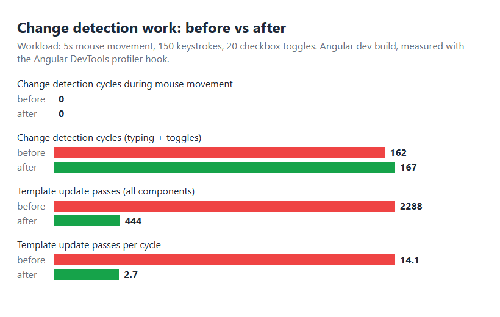

# Performance Report

## Baseline (legacy monolithic component)

Anti-patterns present before refactoring:

- `getStats()` called ~8x per change-detection cycle, each running a 10,000-iteration loop
- `getProgressPercentage()` re-invokes `getStats()`
- Default change detection (no `OnPush`)
- `*ngFor` + `*ngIf` filtering, `trackByFn` returned the whole object
- Manual RxJS subscription, no response caching
- `bypassSecurityTrustHtml` + `[innerHTML]` on user input (XSS)
- `any` types and in-place array mutation

### Profiler capture (before vs after)

Method: headless Chrome driven by a script against the Angular dev server, hooked into Angular's
profiler API (, the same hook Angular DevTools uses). Both versions get an identical
workload: 5s of mouse movement over the component, 150 keystrokes in the input, 20 checkbox toggles.
The baseline is commit ; the after is . Raw numbers: .

| Metric | Before | After |
| --- | --- | --- |
| Change detection cycles during 5s mouse movement | 0 | 0 |
| Change detection cycles (150 keystrokes + 20 toggles) | 162 | 167 |
| Template update passes (all components, same workload) | 2288 | 444 (-81%) |
| Template update passes per change detection cycle | 14.1 | 2.7 |

Screenshots of the running app: , .

### Reading the numbers honestly

- **Mouse movement alone triggers no change detection** in either version: the app has no
   listener, so zone.js never schedules a cycle. The lab's premise (cycles while moving the
  mouse) only holds if a listener or timer exists. Keystrokes, clicks and toggles are what trigger cycles.
- **The number of cycles is unchanged** (~165): zone.js runs one cycle per event, with or without
  OnPush. OnPush and signals reduce the *work inside* each cycle, which is why template update passes
  fall by 81%: unchanged  child components are skipped, and nothing re-evaluates .
- **Wall-clock CPU time was not measurably different** in this workload. In production builds, total
  task time over 3 runs each was 0.96 / 1.35 / 1.11 s before and 1.18 / 1.49 / 1.07 s after, which is
  within noise, because the legacy busy loop () has an empty body and is optimized away by
  V8, and the run is dominated by simulated typing delays. The savings are real in terms of work
  performed and scale with list size, but they are not visible as a time difference here.

## What changed

| Problem | Fix |
| --- | --- |
| Template method calls (`getStats()` x8 + busy loop) ran every CD cycle | `computed()` signals in `TodoService`; evaluated only when `todos` changes |
| Default change detection | `ChangeDetectionStrategy.OnPush` on every component |
| `*ngFor` + `*ngIf`, `trackByFn` returned the object | `@for (... track todo.id)` over pre-filtered `activeTodos` / `completedTodos` computeds |
| Mutable state (`push`, in-place edits) | `signal()` with immutable `update()` (spread / map / filter) |
| Manual subscribe / unsubscribe | `async` pipe; no lifecycle hooks |
| Uncached simulated API | `defer` + `shareReplay({ bufferSize: 1 })`; verified by `welcome.service.spec.ts` |
| XSS: `bypassSecurityTrustHtml` + `[innerHTML]` on user input | Task text rendered with interpolation (escaped); header sanitized via `DomSanitizer.sanitize(SecurityContext.HTML, ...)`; bypass removed |
| Monolithic component, `any` types | `TodoService`, `WelcomeService`, typed `Todo` model, and `TodoInput` / `TodoStats` / `TodoList` / `TodoItem` components |

### XSS note

The vulnerability was `bypassSecurityTrustHtml`, which switches Angular's sanitizer off, combined with
`[innerHTML]` on untrusted strings. The old `<script>` string check in `addTask` was not a defence
(`` bypasses it). The fix is to never bypass the sanitizer and to render user text via
interpolation.

## Optional manual step

For a manual cross-check, repeat the recording in Chrome DevTools > Performance and Angular DevTools > Profiler against  and .
